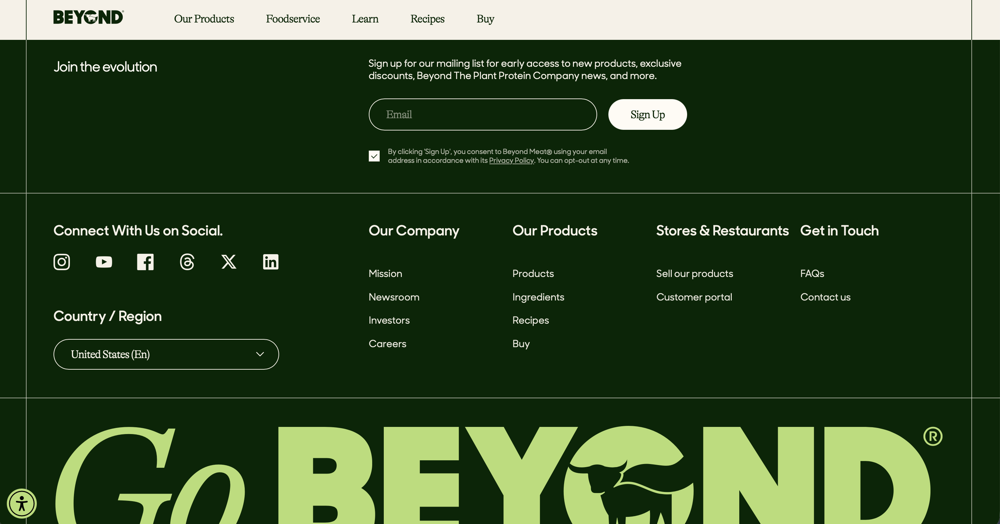

---
format:
  revealjs:
    css: group9_beyond_meat_theme.css
    embed-resources: true
    slide-number: true
    scrollable: false
    controls: true
    progress: true
    width: 1280
    height: 720
    margin: 0.08
    min-scale: 0.2
    max-scale: 2.0
    center: false
footer: "IBM6200 |"
---

:::: title-slide


::: title-copy
<h1>Beyond Meat Case Study</h1>

<p class="subtitle">

Group 9

</p>
:::
::::

## Problem

## Objectives

## Marketing Program

## Digital Marketing Practice

### Beyond Meat’s Website

:::::: {style="font-size: 0.45em; line-height: 1.1;"}
::::: columns
::: {.column width="58%"}
```{=html}

```

<small>Source: Beyond Meat official website \[2\]</small>
:::

::: {.column width="42%"}
### Why This Channel is Effective

- **Brand positioning:** Communicates Beyond Meat’s plant-based identity
- **Product education:** Shows products and product information
- **Consumer support:** Uses FAQs to answer questions and reduce uncertainty
- **Consumer engagement:** Uses an email newsletter to maintain contact
- **Purchase consideration:** Helps consumers explore products before buying

**Takeaway:** The website attracts, informs, and keeps consumers engaged throughout the buying process.
:::
:::::
::::::

------------------------------------------------------------------------

## Competitive Analysis

:::::: {style="font-size: 0.55em; line-height: 1.1;"}
::::: columns
::: {.column width="50%"}
### Market Size

**Historical case data**

- U.S. meat industry revenue in 2013: **\$219 billion**
- U.S. meat industry net profits in 2013: **\$19 billion**
- Traditional meat industry growth: **approximately 4%**
- Meat-alternative market in 2012: **\$553 million**
- Meat-alternative market growth: **8%**
:::

::: {.column width="50%"}
### Competitor Categories

**Direct competitors**

- LikeMeat
- Impossible Foods
- MorningStar Farms

**Traditional and cross-category competitors**

- Tyson Foods
- Pilgrim’s Pride
- Sanderson Farms
- Perdue Farms
:::
:::::

**Takeaway:** Beyond Meat entered a much larger traditional meat industry, while faster growth in meat alternatives created an opportunity for expansion.

<small>Source: Beyond Meat case, pp. 13–14 \[1\]</small>
::::::

------------------------------------------------------------------------

## Competitive Analysis

::: {style="font-size: 0.50em; line-height: 1.05;"}
### Direct and Indirect Competitors

+--------------------------------+------------------------------------------------+-------------------------------------------------------------+
| Competitor group               | Companies                                      | Why they matter                                             |
+================================+================================================+=============================================================+
| Direct plant-based competitors | LikeMeat, Impossible Foods, MorningStar Farms  | Compete for consumers seeking meat alternatives             |
+--------------------------------+------------------------------------------------+-------------------------------------------------------------+
| Traditional meat competitors   | Pilgrim’s Pride, Sanderson Farms, Perdue Farms | Compete for consumers’ established meat purchases           |
+--------------------------------+------------------------------------------------+-------------------------------------------------------------+
| Cross-category competitor      | Tyson Foods                                    | Traditional meat company also entering plant-based products |
+--------------------------------+------------------------------------------------+-------------------------------------------------------------+
| Focal company                  | Beyond Meat                                    | Must differentiate its products and positioning             |
+--------------------------------+------------------------------------------------+-------------------------------------------------------------+

### Basis of Competition

- **Consumer benefits:** Health, environmental impact, taste, and convenience
- **Consumer adoption:** Familiar packaging, placement, and meal occasions
- **Market challenge:** Convincing consumers to change established food habits
- **Strategic question:** Whether to emphasize meat-like taste and texture, health and environmental benefits, or a combination

**Takeaway:** Beyond Meat competes with both plant-based brands and traditional meat companies. Its key challenge is differentiating itself while making plant-based meat acceptable to mainstream consumers.

<small>Source: Beyond Meat case, pp. 13–14 \[1\]</small>
:::

------------------------------------------------------------------------

## SWOT Analysis

::: {style="font-size: 0.55em; line-height: 1.0;"}
+----------------------------------------+-----------------------------------------------------+
|                                        |                                                     |
+========================================+=====================================================+
| **STRENGTHS**                          | **WEAKNESSES**                                      |
|                                        |                                                     |
| - Growing alternative-protein market   | - Consumer attachment to traditional meat           |
|                                        |                                                     |
| - Health and environmental positioning | - Uncertainty about changing eating habits          |
|                                        |                                                     |
| - Website and consumer education       | - Taste and texture concerns                        |
+----------------------------------------+-----------------------------------------------------+
| **OPPORTUNITIES**                      | **THREATS**                                         |
|                                        |                                                     |
| - Health-conscious consumers           | - LikeMeat, Impossible Foods, and MorningStar Farms |
|                                        |                                                     |
| - Flexitarians and meat reducers       | - Tyson’s entry into plant-based products           |
|                                        |                                                     |
| - Mainstream consumer acceptance       | - Resistance to changing food habits                |
+----------------------------------------+-----------------------------------------------------+

<p style="color:#123D24; font-size:0.9em;">

<strong>Takeaway:</strong> Beyond Meat can use health positioning and consumer education to build mainstream acceptance, but it must overcome competition and resistance to behavior change.

</p>

<small style="color:#123D24;">Source: Beyond Meat case, pp. 13–14 \[1\]</small>
:::

```{=html}
<!-- References:

1. Beyond Meat: Changing Customer Behaviour in Food Consumption. Harvard Business Review. 2020.

2. Beyond Meat. Beyond Meat. Accessed October 11, 2026. https://www.beyondmeat.com/

-->
```

## Research Framework: ELM

:::::: {style="font-size: 0.52em; line-height: 1.15;"}
::::: columns
::: {.column width="48%"}
[How the Theory Works]{style="color:#B7E66A; font-size:1.15em; font-weight:600;"}

**Central Route**

- Consumers carefully evaluate arguments and evidence before making a decision.

*Example:* Reviewing nutritional and environmental claims before deciding to try Beyond Meat.

**Peripheral Route**

- Consumers rely on persuasive cues rather than detailed analysis like packaging, advertisements, or endorsements.

*Example:* Responding to packaging because of how Beyond Meat is presented.
:::

::: {.column width="48%"}
[Application to Beyond Meat]{style="color:#B7E66A; font-size:1.15em; font-weight:600;"}

**Consumer Challenge**

- Familiar meat preferences and taste concerns may cause hesitation to try plant-based alternatives.

**Research Approach**

- Using ELM we can research whether consumers respond more to detailed, evidence-based messaging or simpler promotional messages.

**Role of Involvement**

- Examine whether involvement changes responses to different messages. Someone who is into nutrition might respond differently than someone who is just purchasing because of the appeal of the product.
:::
:::::

**Key Takeaway:** Different consumers may require different persuasive approaches. Understanding those differences can help Beyond Meat develop marketing messages that encourage consumers to give its products a try.

<small>Source: Petty, Cacioppo, and Schumann (1983).</small>
::::::

## Research Framework: TPB

:::::: {style="font-size: 0.52em; line-height: 1.15;"}
::::: columns
::: {.column width="48%"}
[How the Theory Works]{style="color:#B7E66A; font-size:1.15em; font-weight:600;"}

**Attitudes**

- Consumers evaluate whether trying plant-based meat would be beneficial or undesirable based on their beliefs on plant-based products.

**Subjective Norms**

- Perceived approval or disapproval from family, friends, and other important people.

**Perceived Behavioral Control**

- How easy or difficult consumers believe it would be to try or purchase meat alternatives. This includes price and availability.
:::

::: {.column width="48%"}
[Application to Beyond Meat]{style="color:#B7E66A; font-size:1.15em; font-weight:600;"}

**Consumer Challenge**

- Familiar eating habits, taste concerns. or plant-based foods uncertainty might discourage consumers from trying Beyond Meat.

**Research Approach**

- Measure consumers' attitudes, perceived social expectations, and barriers to trying Beyond Meat.

**Purchase Intentions**

- Analyze which factors are associated with consumers' intentions to try Beyond Meat.
:::
:::::

**Key Takeaway:** Attitudes, social influences, and perceived control help explain consumers' intentions to try Beyond Meat.

<small>Source: Ajzen (1991).</small>
::::::

## Methods: Research Design & Data Collection

:::::: {style="font-size: 55%;"}
::::: columns
::: {.column width="50%"}
### Research Approach

**Experimental Study**

- Examine how marketing messages and product experiences influence consumers' willingness to try Beyond Meat.

**Target Participants**

- Traditional meat eaters with different levels of interest in nutrition and sustainability.

### What We Want to Test

- **Marketing Messages:** Taste and texture versus health and sustainability.
- **Product Experience:** Whether tasting Beyond Meat changes consumer perceptions.
- **Consumer Involvement:** Whether personal interests affect responses.
:::

::: {.column width="50%"}
### Data Collection

**Consumer Surveys**

- Measure attitudes and purchase intentions before and after exposure.

**Experimental Groups**

- Randomly assign participants to four groups based on marketing messages and product tasting.

**Consumer Behavior**

- Observe product choices to understand willingness to try Beyond Meat.
:::
:::::
::::::

## Methods: Measurement & Data Analysis

:::::: {style="font-size: 44%;"}
::::: columns
::: {.column width="50%"}
### What We'll Measure

**Consumer Attitudes**

- How consumers feel about Beyond Meat's taste, health benefits, and overall appeal.

**Social Influence**

- How friends, family, and social expectations affect purchase decisions.

**Purchase Barriers**

- Whether price, availability, or familiarity prevent consumers from trying Beyond Meat.

**Purchase Intentions**

- How likely consumers are to try or purchase Beyond Meat.
:::

::: {.column width="50%"}
### How We'll Analyze the Results

**Before & After Comparison**

- Compare survey responses to see whether attitudes and purchase intentions change.

**Experimental Groups**

- Compare the four groups to see which marketing messages and product experiences work best.

**Consumer Involvement**

- Examine whether interest in nutrition and sustainability influences responses.

### Research Goal

- Understand what influences consumers' willingness to replace traditional meat with Beyond Meat, identify barriers to adoption, and determine which product benefits and marketing messages are most effective at encouraging that change.
:::
:::::
::::::

## Recommendations: Marketing Strategy

:::::: {style="font-size: 48%;"}
::::: columns
::: {.column width="50%"}
### Taste & Product Experience

**Address Consumer Concerns**

- Show consumers how Beyond Meat compares to traditional meat, especially when it comes to taste and texture.

**Encourage Product Trials**

- Give consumers opportunities to try Beyond Meat firsthand so they can decide whether the product meets their expectations.

### Consumer Targeting

**Reach Traditional Meat Eaters**

- Focus on consumers who are interested in eating less meat but aren't necessarily looking to completely change their diets.
:::

::: {.column width="50%"}
### Marketing Messages

**Focus on Taste**

- Highlight taste, texture, and how Beyond Meat can fit into meals consumers already enjoy.

**Highlight Other Benefits**

- Communicate the health and environmental benefits to consumers who are more interested in those factors.

### Applying Our Research

**Use Consumer Feedback**

- Use findings from the proposed research to understand which messages connect with consumers and what might be preventing them from trying Beyond Meat.
:::
:::::
::::::

## Recommendations: Implementation & Managerial Implications

:::::: {style="font-size: 48%;"}
::::: columns
::: {.column width="50%"}
### Putting the Strategy Into Action

**Product Sampling**

Offer in-store tasting opportunities to help consumers become more comfortable trying Beyond Meat.

**Targeted Marketing**

Develop messages that highlight different benefits based on what matters most to consumers.

**Product Positioning**

Show how Beyond Meat can be used in familiar meals without requiring consumers to completely change their diets.
:::

::: {.column width="50%"}
### Business Implications

**Marketing Investments**

Prioritize the messages and promotional activities that show the strongest potential to influence purchasing decisions.

**Consumer Adoption**

Focus on encouraging repeat purchases rather than relying only on consumers trying the product once.

**Long-Term Growth**

Build a strategy that makes Beyond Meat a realistic alternative to traditional meat for everyday consumers.

### Managerial Takeaway

Use consumer insights to guide product positioning, marketing decisions, and long-term adoption strategies.
:::
:::::
::::::
